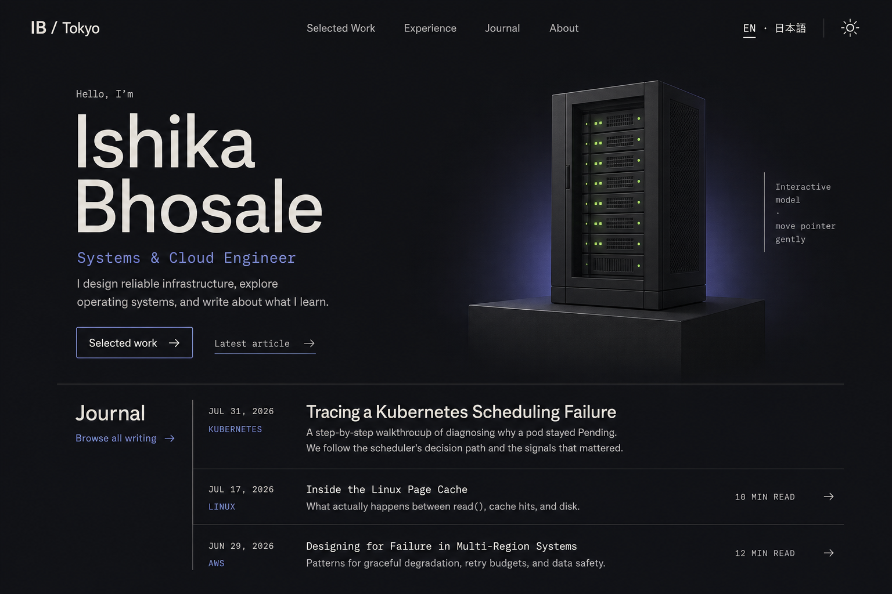

# Ishika Bhosale Personal Portfolio — Design Specification

Date: 2026-07-31

## Objective

Build a fast, accessible personal portfolio at `https://ishikabhosale.github.io` that presents Ishika as a systems and cloud engineer, highlights selected work, and makes technical writing easy to publish and share.

The site takes visual cues from [Naresh Khatri's 3D portfolio](https://github.com/Naresh-Khatri/3d-portfolio) while deliberately removing its cursor effects, arrow-driven interaction, particle field, counters, and pervasive motion. It borrows the clear blog and interface-language affordances of [Hugo Profile](https://github.com/gurusabarish/hugo-profile) without adopting Hugo.

## Approved Visual Target

The approved direction is Option 3, the “Tokyo Systems Journal” concept:

The visual system uses:

- a warm near-black canvas with soft ivory text;
- deep indigo as the primary accent and tiny green server-status lights;
- a contemporary Swiss-style sans-serif with restrained monospace metadata;
- strong editorial alignment, thin rule lines, squared geometry, and generous whitespace;
- one plinth-mounted, low-poly server rack as the sole 3D object;
- a prominent technical-journal index rather than a dashboard or grid of generic cards.

## Audience and Primary Outcomes

The primary audience is recruiters, engineering peers, and collaborators evaluating Ishika's systems, cloud, and software-engineering work.

Visitors should be able to:

1. understand Ishika's professional focus within the first viewport;
2. inspect a small set of meaningful projects and experience highlights;
3. discover and open technical articles quickly;
4. share any article using a permanent URL;
5. switch the site's interface between English and Japanese;
6. reach Ishika through GitHub, LinkedIn, or email.

## Scope

### Included

- responsive homepage;
- selected project detail pages;
- writing index and individual article pages;
- English and Japanese interface labels;
- dark and light themes, with dark as the visual reference;
- one progressively enhanced 3D server-rack hero;
- RSS, sitemap, canonical URLs, social metadata, and a custom 404 page;
- GitHub Pages deployment through GitHub Actions.

### Excluded from the first release

- contact-form backend;
- CMS or database;
- comments, reactions, accounts, analytics dashboards, or visitor counters;
- full translation of project descriptions or article bodies;
- search, advanced filtering, or a complex tag taxonomy;
- realtime cursors, chat, presence, or other multiplayer features.

## Information Architecture

### Homepage

The homepage is a compact, vertically flowing portfolio containing:

1. persistent header and interface controls;
2. hero with name, role, short positioning statement, primary links, and server rack;
3. three selected projects;
4. concise experience timeline;
5. latest three journal entries;
6. short about/contact area and credits-aware footer.

The desktop header contains `IB / Tokyo`, Selected Work, Experience, Journal, About, EN/日本語, and the theme control. The mobile header collapses into an accessible menu.

### Writing

- Index: `/writing/`
- Article: `/writing/<slug>/`

Every article receives a stable, title-based URL without a date segment. Example:

`https://ishikabhosale.github.io/writing/tracing-a-kubernetes-scheduling-failure/`

Article pages include title, description, publication and update dates, reading time, topic, authored language, code highlighting, an optional table of contents, copy-link control, previous/next links, and social metadata.

The writing index may filter by a small topic list. It does not include search in the first release.

### Projects

- Project: `/work/<slug>/`

Each project page contains the problem, approach, architecture, outcome, screenshots where available, technologies, and repository/demo links.

### Japanese Interface

Localized interface routes use the `/ja/` prefix for the homepage and content indexes. The language switch preserves the equivalent page whenever a localized shell exists. Article bodies and project descriptions remain exactly as authored. Duplicate localized shells use canonical metadata that points at the article's primary URL.

## Content Model

Astro Content Collections provide build-time schema validation.

### Writing entry

Required fields:

- `title`
- `description`
- `publishedAt`
- `slug`
- `language`
- `topic`
- `draft`

Optional fields:

- `updatedAt`
- `coverImage`
- `featured`
- `repositoryUrl`

The body is Markdown or MDX. Draft entries are excluded from production builds.

### Project entry

Required fields:

- `title`
- `summary`
- `slug`
- `technologies`
- `featured`
- `order`

Optional fields:

- `repositoryUrl`
- `demoUrl`
- `coverImage`
- `year`

The body holds the project narrative and architecture detail.

### Experience and profile

Profile, social links, skills, and experience live in typed data modules. Initial content uses known public information—Tokyo, systems/cloud engineering, C/C++, Go, Kubernetes, JavaScript, and operating-systems interests—and remains straightforward to replace with resume-derived copy later.

## Technical Architecture

### Static application

Astro generates static HTML for GitHub Pages. The site uses Astro layouts and components for every route except the interactive hero island.

### 3D island

The server rack is implemented as an isolated React island using React Three Fiber. Three.js and model code load only for the hero and only after the static poster is present.

The preferred asset is [(Low Poly) Server Rack](https://sketchfab.com/3d-models/low-poly-server-rack-07fd533bdc274fe29a0e9a9ebe48e5b3) by Thestupidkid1432. Sketchfab identifies it as downloadable, approximately 4,032 faces, and licensed under [CC BY 4.0](https://creativecommons.org/licenses/by/4.0/). Attribution appears in `CREDITS.md` and the site footer.

The downloaded model is stored locally as a GLB, optimized for web delivery, and accompanied by a generated poster image. It is never loaded from a third-party embed at runtime.

### Localization

Small typed dictionaries hold all interface labels. A build-time parity check ensures English and Japanese dictionaries contain identical keys. The visitor's choice is remembered locally. Authored content is not machine-translated.

### Deployment

A GitHub Actions workflow:

1. checks out `main`;
2. installs the locked dependencies;
3. validates content and interface dictionaries;
4. builds the Astro site;
5. uploads the static artifact;
6. deploys it to GitHub Pages.

## Component Boundaries

- `SiteHeader`: navigation, language control, and theme control.
- `Hero`: static copy and action links surrounding the 3D slot.
- `ServerRackScene`: model loading, pointer response, lighting, fallback signaling, and cleanup.
- `SelectedWork`: ordered project summaries sourced from the project collection.
- `ExperienceTimeline`: concise experience data rendering.
- `JournalIndex`: featured and recent writing entries.
- `ArticleLayout`: metadata, prose, table of contents, copy link, and article navigation.
- `SiteFooter`: contact links, licensing credit, and RSS link.

Each component owns a focused responsibility. Content components receive typed data and do not fetch data in the browser.

## Interaction Design

### Server rack

- follows pointer movement by only a few degrees;
- eases gently back to its resting pose;
- uses no dramatic scroll animation, particles, cursor replacement, or navigation mechanic;
- is nonessential to understanding or operating the site;
- becomes static on touch-first and narrow-screen layouts by default.

### Navigation and controls

- section links scroll smoothly only when reduced motion is not requested;
- keyboard focus is clearly visible;
- theme and language controls use explicit accessible labels;
- the copy-link action announces success without shifting layout;
- no important interaction depends on hover alone.

## Resilience and Error Handling

- The hero displays an optimized poster before the GLB loads.
- Reduced-motion, data-saving, touch-first, WebGL-unavailable, or model-load-failure states retain the poster permanently.
- Missing required content fields fail the build with a targeted validation error.
- Mismatched translation keys fail the validation step.
- Unknown article and project slugs resolve to the custom 404 page.
- External links identify themselves and use safe new-tab behavior where appropriate.
- The site remains navigable and readable if client-side JavaScript fails.

## Accessibility and Performance

- semantic headings, landmarks, lists, links, and buttons;
- skip link and visible focus styles;
- WCAG AA color contrast;
- comfortable article measure and 15–16px base text;
- responsive typography without clipped or overlapping content;
- `prefers-reduced-motion` support across CSS and the 3D island;
- optimized fonts, local images, lazy loading below the fold, and constrained JavaScript;
- decorative 3D content excluded from the accessibility tree while its surrounding context remains meaningful.

The intended performance profile is static HTML first, with the hero as the only substantial interactive bundle.

## SEO and Sharing

Every public page includes:

- unique title and description;
- canonical URL;
- Open Graph and social-card metadata;
- structured article metadata when applicable;
- sitemap entry unless explicitly excluded;
- consistent favicon and social-preview artwork.

The writing collection generates an RSS feed. Copy-link uses the canonical article URL.

## Verification Strategy

### Automated

- production build and type checking;
- content-schema and translation-key validation;
- unit tests for URL, locale, and content helpers;
- internal-link validation;
- component tests for language, theme, and copy-link behavior;
- accessibility checks on representative pages.

### Browser verification

- desktop and mobile responsive layouts;
- keyboard-only navigation;
- reduced-motion and static-poster behavior;
- light and dark themes;
- English and Japanese interface routes;
- article sharing metadata and canonical URLs;
- missing-model and JavaScript-disabled fallbacks;
- visual comparison of the homepage against the approved Option 3 image.

## Acceptance Criteria

The first release is ready when:

1. the homepage visibly matches the approved Option 3 direction at desktop and adapts cleanly to mobile;
2. the server rack interaction is restrained and all fallback modes work;
3. English and Japanese interface routes contain matching controls and labels;
4. at least one representative article and project build from typed content;
5. every article has a permanent shareable URL and valid social metadata;
6. the site passes the production build, link, accessibility, and responsive checks;
7. GitHub Pages can deploy the generated artifact from `main`.
